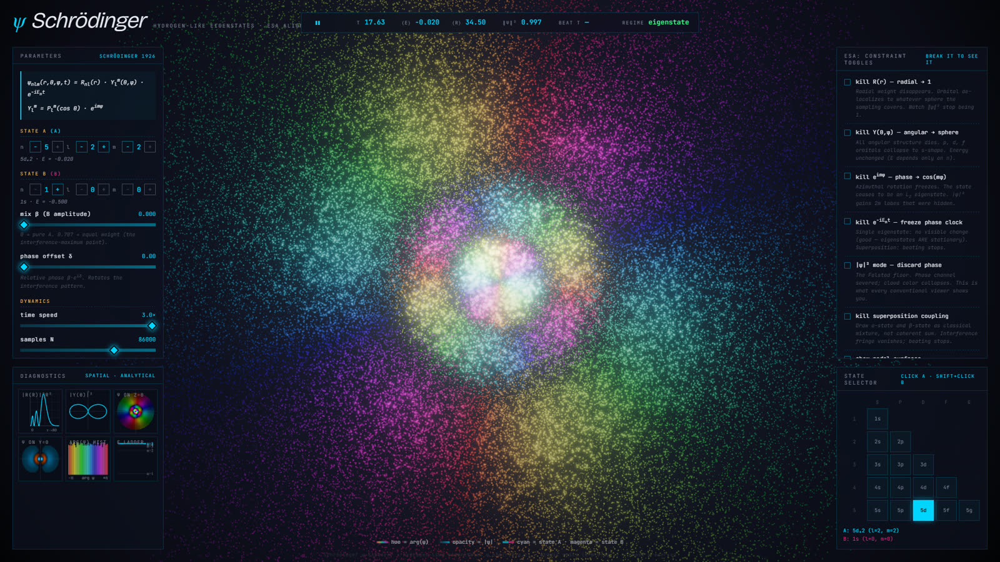

# Schrödinger ψ-Explorer

**[▶ Open it live in your browser](https://r0yb0t1th3s3.github.io/Schrodinger-Explorer/)** · no install, one file

An interactive 3D viewer for hydrogen-like quantum eigenstates that renders the
**full complex wavefunction** — both its amplitude and its phase — rather than
the probability density alone.

Most quantum-orbital viewers show you |ψ|²: where the electron is likely to be.
That picture is real, but it throws away half of what the wavefunction is. The
phase — the complex angle arg(ψ) at every point — carries angular momentum, the
time evolution, and all interference between states. This tool keeps that
channel and puts it on screen.

## What it shows

The wavefunction is sampled as a cloud of fixed points in space. At each point,
every frame, the tool evaluates the analytic hydrogen solution
ψ_nlm(r,θ,φ,t) = R_nl(r) · Y_l^m(θ,φ) · e^(−iE_n t) and maps:

- **opacity → |ψ|** (how much amplitude is there)
- **hue → arg(ψ)** (the phase, as a color wheel)

So the shape of the cloud is the probability density, and the coloring is the
phase. Two states can have identical density and completely different phase
structure; here you can see the difference.

## Controls

**State A / State B** — pick quantum numbers (n, l, m) for one or two states.
In the State Selector panel, click a cell for A; shift-click for B.

**mix β** — superpose the two states. β = 0 is pure A; β = 0.707 is the
equal-weight interference maximum. **phase offset δ** rotates the relative phase
between them, sweeping the interference pattern.

**time speed / pause** — the wavefunction evolves in time. Pure eigenstates are
stationary in |ψ|² (their density does not move — that is physically correct).
Non-degenerate superpositions **beat**: the density sloshes back and forth at a
period set by the energy difference (shown as "beat T" in the readout).
Play/pause sits in the top readout bar and on the spacebar.

**samples N / brightness** — point-cloud density and glow. Each point's brightness
is capped so the hue survives in the dense core instead of washing out to white;
raising brightness lifts the faint outer shells.

**focus** — frames the whole cloud along the current view. The view also reframes
itself whenever n changes, so a small 1s state never shrinks to a dot and a large
n = 5 state never overflows the screen. On load the explorer opens on 5d, m = +2
looking straight down the z-axis: the camera starts inside the cloud and pulls
back until the full state is in frame. Drag, scroll or touch at any time to take over.

## ESA constraint toggles

The right-hand panel lets you switch off individual factors of the wavefunction
and watch what each one was doing. Each toggle is a controlled deletion:

- **kill R(r)** — remove the radial part. The orbital de-localizes; ‖ψ‖² stops
  being 1. (The radial factor is what makes the electron bound to a finite
  region.)
- **kill Y(θ,φ)** — remove the angular part. All orbitals collapse to spherical
  s-shape. Energy is unchanged, because energy depends only on n.
- **kill e^(imφ)** — freeze the azimuthal phase into a real standing wave. The
  state stops being an L_z eigenstate and hidden lobes appear.
- **kill e^(−iE_n t)** — freeze the phase clock. A single eigenstate looks
  unchanged (they are stationary anyway); a superposition stops beating.
- **|ψ|² mode** — discard phase entirely. This is the conventional density-only
  view every standard orbital viewer shows. Useful as a direct before/after.
- **kill superposition coupling** — render A and B as a classical statistical
  mixture instead of a coherent superposition: the cross (interference) term is
  removed, and the cloud goes phaseless grey, because a mixture carries no global
  phase.
- **show nodal surfaces** — highlight where ψ = 0. Node count is n − 1.
- **show Bohr radius** — a wire sphere at r = n²·a₀, the old classical prediction.

## Reveal — the phase clock, running

**Reveal** (off by default) makes the time evolution of the phase visible. A
heartbeat-like front sweeps through the fixed cloud, tracking surfaces of
constant phase as the e^(−iE_n t) clock advances. Points flare with their true
phase color as the front reaches them, then the color fades while the brightness
trails behind — a colored crest with a luminous wake.

Three things about that sweep are properties of the state itself, fixed in space
no matter how you rotate or interact with the view:

- **rate = |E_n|** — the heartbeat tracks the energy of the state you have
  selected (the dominant one, in a superposition). More tightly bound states beat
  faster, so the 1s ground state is the fastest of all. The **pace** slider scales
  this into an easily-watched range (1.0× is the literal energy) without changing
  which states beat faster than which.
- **number of arms = |m|** — the magnetic quantum number, read directly off how
  many fronts circle the z-axis at once.
- **handedness = sign(m)** — the direction of circulation. Orbit the camera to
  the other side and your view flips, but the circulation in space does not.

Reveal adds no net amplitude: averaged over one cycle, each point's brightness is
still |ψ|. It re-times *when* each point announces its phase; it does not change
what is there. Turn it off and |ψ|² is stationary again — which, for an
eigenstate, is the honest picture.

## Running it

**Live:** https://r0yb0t1th3s3.github.io/Schrodinger-Explorer/

Or open `index.html` locally in a modern browser with WebGL2 (Firefox or Chrome).
No build step, no server — it is a single self-contained file using Three.js from a CDN.

## Files

- `index.html` — the application (UI, physics, WebGL rendering).
- `theory.md` — the design rationale and the per-toggle predictions.
